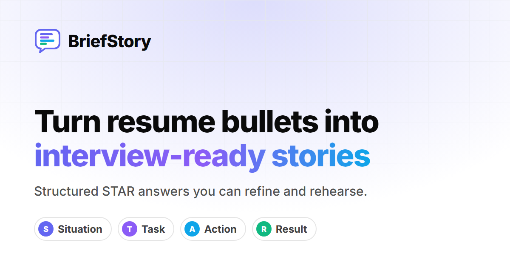
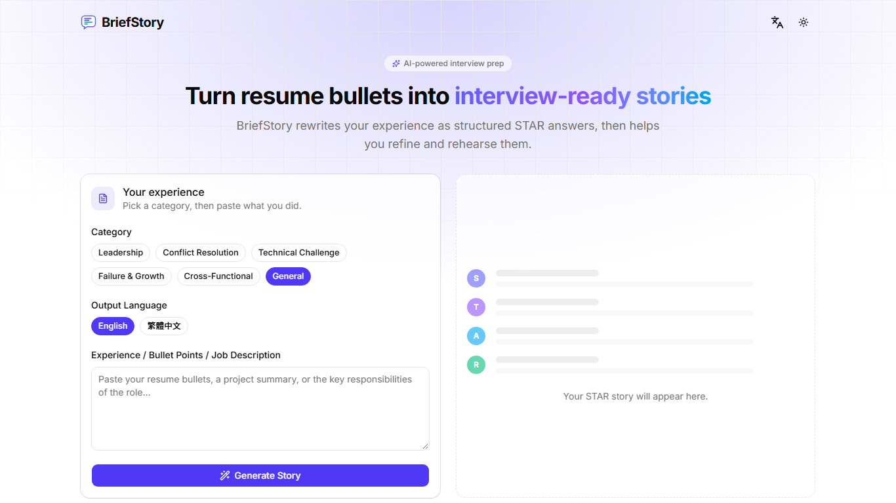
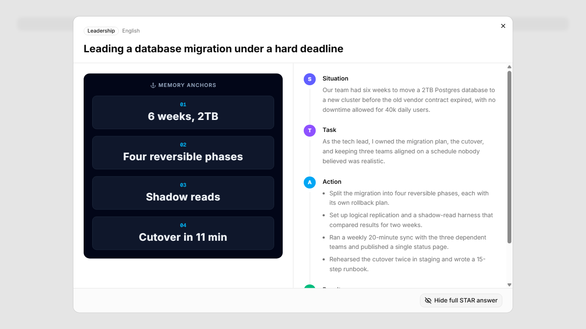
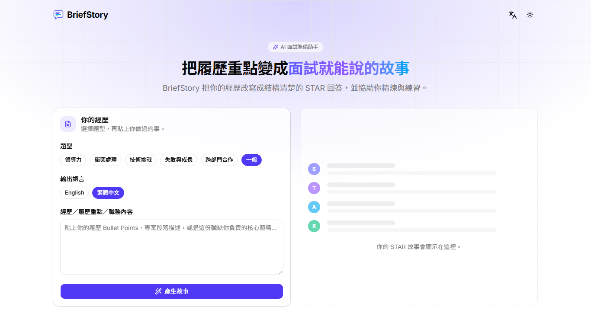
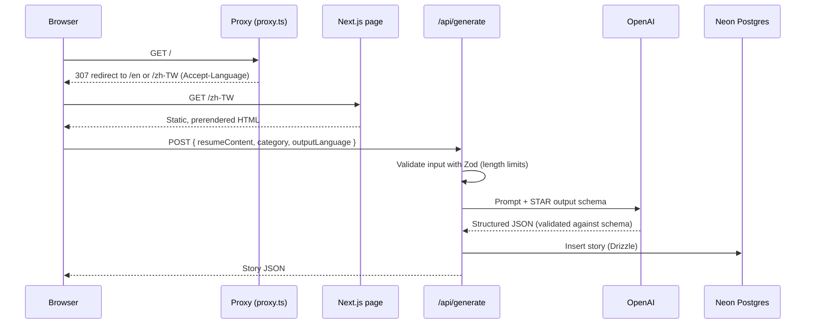

<div align="center">


# BriefStory

**Turn resume bullets into interview-ready STAR stories, then refine and rehearse them.**

[briefstory.app](https://briefstory.app) · English / 繁體中文 · Built by [Sam Chiu](https://samchiu.dev)



</div>

---

## Why BriefStory

Behavioral interviews ask questions like _"Tell me about a time you led a project under pressure."_ The usual advice is to answer with the **STAR method** (Situation, Task, Action, Result), but turning a one-line resume bullet into a clear, specific STAR story is hard, and memorizing a full script makes answers sound rehearsed.

BriefStory helps with both steps:

1. **Generate:** paste a resume bullet or project summary, pick a question category, and get a structured STAR answer.
2. **Refine:** add the details the first draft missed (numbers, stakeholders, trade-offs) and get a sharper version.
3. **Rehearse:** practice from four short **memory anchors** instead of a script, then reveal the full answer to check yourself.

## Features

- **STAR story generation** for six behavioral categories (Leadership, Conflict Resolution, Technical Challenge, Failure & Growth, Cross-Functional, General), with follow-up tips when key details are missing.
- **Iterative refinement**: feed extra context back in to improve the same story.
- **Teleprompter practice mode**: large memory-anchor cards next to the full answer, which stays blurred until you choose to reveal it, like a flashcard.
- **Bilingual UI and output**: the interface is available in English and Traditional Chinese, and the story language can be chosen separately.
- **Light and dark themes** that follow the system setting, with no flash of the wrong theme on load.
- **Responsive and accessible**: keyboard and screen-reader friendly controls, and reduced-motion support.

## Screenshots

| Story generator | Teleprompter practice mode |
| --- | --- |
|  |  |

<details>
<summary>Traditional Chinese (zh-TW) interface</summary>



</details>

## Tech stack

| Area | Technology |
| --- | --- |
| Framework | [Next.js 16](https://nextjs.org) (App Router, Turbopack, Cache Components), [React 19](https://react.dev), TypeScript |
| AI | [Vercel AI SDK](https://ai-sdk.dev) with OpenAI `gpt-4o-mini`, structured output validated by [Zod](https://zod.dev) |
| Database | [Neon](https://neon.tech) serverless Postgres, [Drizzle ORM](https://orm.drizzle.team) and Drizzle Kit |
| UI | [Tailwind CSS v4](https://tailwindcss.com), [shadcn/ui](https://ui.shadcn.com) on [Base UI](https://base-ui.com), [Lucide](https://lucide.dev) icons |
| Internationalization | [next-intl](https://next-intl.dev) with locale-prefixed routes (`/en`, `/zh-TW`) |
| Theming | [next-themes](https://github.com/pacocoursey/next-themes) |
| Hosting | AWS Amplify |
| Tooling | pnpm, ESLint, Prettier |

## How it works



`/api/refine` follows the same path. It sends the current story plus the user's extra context and returns an improved version.

## Engineering highlights

- **Server Components by default.** The page is a Server Component, and only the interactive generator (`components/generator/`) is a client component. The hero, features, and footer render on the server and ship no JavaScript.
- **Type-safe AI output.** The model is asked for structured output matching a Zod schema (`types/story.ts`), so the API always returns a well-formed STAR story or a clear error, never free-form text to parse.
- **Cost controls on a public API.** Input length is capped in one shared place (`lib/limits.ts`), used by both the API validation and the textareas' `maxLength`, and every model call has a `maxOutputTokens` limit, so each request has a bounded cost.
- **Internationalization with static rendering.** Locale-prefixed routes use `next/root-params`, so both `/en` and `/zh-TW` are fully prerendered at build time. Translation keys are type-checked: a missing or misspelled key fails `tsc`.
- **SEO.** Each language version has its own canonical URL, `hreflang` alternates (including `x-default`), Open Graph and Twitter preview images, JSON-LD structured data, `robots.txt`, `sitemap.xml`, and a web manifest.
- **No layout shift in the teleprompter.** Space for the answer is always reserved and the answer starts blurred, so revealing it never moves the content you're reading.

## Project structure

```
app/
  [locale]/
    layout.tsx            Root layout: <html lang>, providers, metadata, JSON-LD
    page.tsx              Home page (Server Component)
  api/
    generate/route.ts     POST: create a STAR story
    refine/route.ts       POST: improve a story with extra context
  robots.ts, sitemap.ts, manifest.ts, icon.svg, apple-icon.png
components/
  generator/              Interactive story generator (client components)
    StoryGenerator.tsx    State and API calls
    StoryForm.tsx, RefinePanel.tsx, StoryResult.tsx, StoryPlaceholder.tsx
  TeleprompterModal.tsx   Practice mode dialog
  SiteHeader.tsx, Hero.tsx, FeaturesSection.tsx, SiteFooter.tsx
  LanguageToggle.tsx, ThemeToggle.tsx
  ui/                     shadcn/ui components
db/
  schema.ts               Drizzle schema (stories table, enums)
  index.ts                Neon database client
i18n/
  routing.ts              Supported locales and default locale
  request.ts              Loads the locale's messages for each request
  navigation.ts           Locale-aware Link, router, and redirect
lib/
  dal/stories.ts          Data access layer for stories
  categories.ts, star.ts, limits.ts, site.ts
messages/
  en.json, zh-TW.json     UI translations
types/
  story.ts                Zod schema for the AI's structured output
proxy.ts                  Redirects / to the visitor's language
amplify.yml               AWS Amplify build configuration
```

## Getting started

### Prerequisites

- Node.js 20.9 or later
- pnpm (the version is pinned in `package.json`; run `corepack enable` to use it automatically)
- A [Neon](https://neon.tech) Postgres database
- An [OpenAI API key](https://platform.openai.com/api-keys)

### Setup

```bash
git clone https://github.com/samchiu064/briefstory.app.git
cd briefstory.app
pnpm install

# Configure environment variables
cp .env.example .env
# then edit .env and fill in DATABASE_URL and OPENAI_API_KEY

# Create the database tables
pnpm db:push

# Start the dev server
pnpm dev
```

Open [http://localhost:3000](http://localhost:3000). You'll be redirected to `/en` or `/zh-TW` based on your browser language.

### Environment variables

| Variable | Required | Description |
| --- | --- | --- |
| `DATABASE_URL` | Yes | Neon Postgres connection string |
| `OPENAI_API_KEY` | Yes | OpenAI API key used by the API routes |
| `NEXT_PUBLIC_SITE_URL` | No | Public site URL for canonical links and previews. Defaults to `https://briefstory.app` |

### Scripts

| Command | Description |
| --- | --- |
| `pnpm dev` | Start the development server |
| `pnpm build` | Create a production build |
| `pnpm start` | Run the production build |
| `pnpm lint` | Run ESLint |
| `pnpm db:push` | Push the Drizzle schema to the database |
| `pnpm db:generate` / `pnpm db:migrate` | Generate and apply SQL migrations |
| `pnpm db:studio` | Open Drizzle Studio to browse the data |

## Deployment

The app is deployed on **AWS Amplify Hosting** using [`amplify.yml`](amplify.yml). Set `DATABASE_URL` and `OPENAI_API_KEY` in the Amplify console under _Environment variables_. The build step writes them into `.env.production` so the API routes can read them at runtime.

## Roadmap

- User accounts and a personal library of saved stories (the schema and data access layer already include `userId` and `getStoriesByUserId`)
- Export stories as PDF or Markdown
- Per-user rate limiting

## Privacy

Text you submit is sent to OpenAI to generate the story, and the input and generated story are stored in the database. Please don't paste confidential information.

## License

Copyright © 2026 [Sam Chiu](https://samchiu.dev). All rights reserved.

This repository is public for viewing and portfolio purposes only. See [LICENSE](LICENSE) for details.
